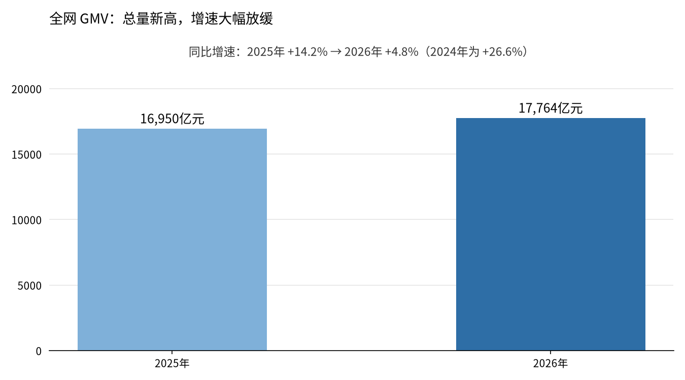
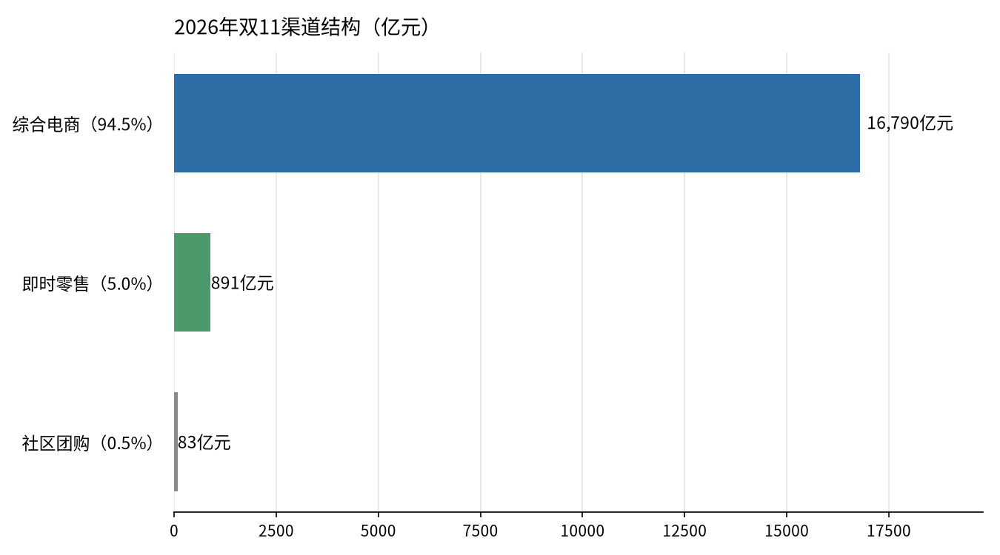
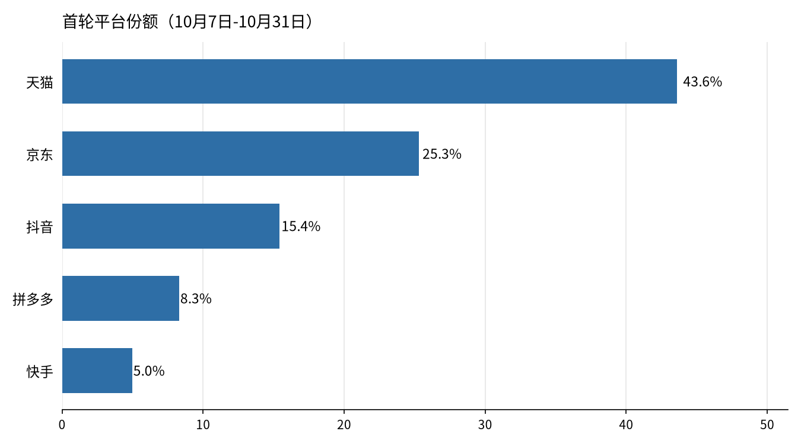
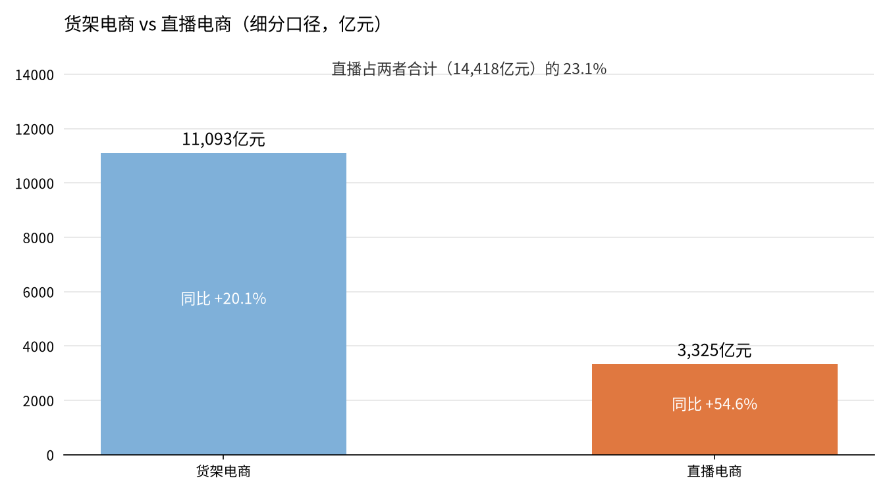
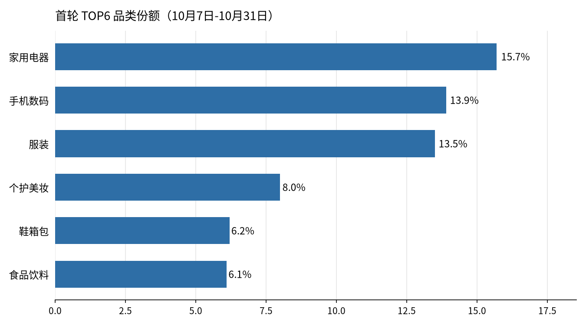
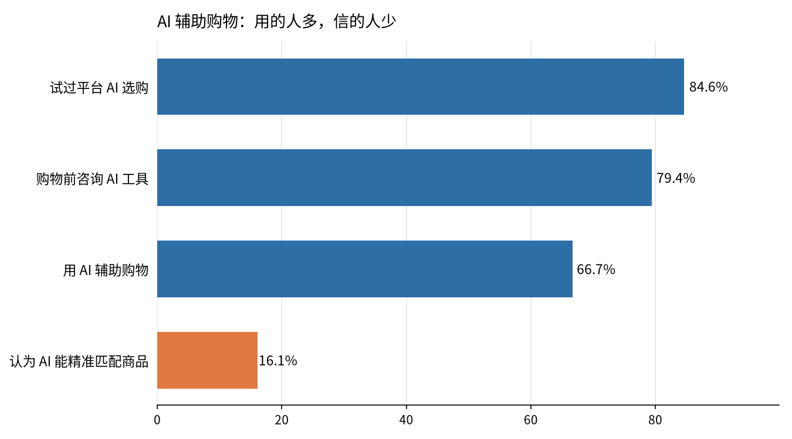

# 2026年双11电商复盘：增长放缓下的结构分化

> 2026年双11（第18届）全网 GMV 17,764 亿元，同比增长 4.8%，增速只有 2025 年（+14.2%）的三分之一。但总量放缓不等于没有变化：直播电商增长 54.6%、即时零售增长 33%、AI 购物助手覆盖四大平台——增量藏在结构里，不在大盘里。

**项目信息**

- 分析对象：2026年双11购物节（2026年10月7日-11月11日，共 36 天）
- 数据来源：星图数据（Syntun）《2026年双十一全网销售数据解读报告》为主，交叉验证来源见第六节
- 方法：纵向对比 + 结构拆解 + 多源交叉验证
- 说明：本报告只用可核查的公开数据；平台自 2022 年起不再公布总 GMV，全部总量数字均为星图数据第三方监测估算，非官方审计数据

## 一、问题

2026年双11走到第18届，三个问题值得回答：

1. **大盘还在涨吗？** 全网 GMV 17,764 亿元，同比 +4.8%，但增速只有 2025 年（+14.2%）的三分之一。增长放缓是周期问题，还是结构问题？
2. **增量在哪里？** 直播电商 +54.6%、即时零售 +33%，远高于综合电商的 +3.7%。平台份额是否也在重排？
3. **AI 改变了什么？** 四大平台同时上线 AI 购物助手，Token 第一次成为商品。AI 是真的在帮消费者做决策，还是只换了个入口？

## 二、数据

### 2.1 核心数据来源

| 来源 | 内容 | 发布 |
|---|---|---|
| 星图数据《2026年双十一全网销售数据解读报告》 | 全网及分渠道 GMV、首轮战报、品类结构 | 2026-11-12 |
| 星图数据 2025 年双11报告 | 2025 年基线（全网 16,950 亿元） | 2025-11-12 |
| 每日经济新闻、金融界、观点网、亿邦动力 | 报告转载与平台官方披露 | 2026-11-12 |
| 中国青年报社社会调查中心联合问卷网 | AI 辅助购物使用率 66.7% | 2026-11-11 |
| 上海消保委《618网购体验消费者调查报告》 | AI 选购信任度数据 | 2026年6月 |
| 中国信通院《大模型词元服务性能监测报告（2026年）》 | Token 日均消耗量 | 2026年 |

### 2.2 口径说明（先说清楚，再看数字）

- **监测周期**：2026年10月7日-11月11日（各平台以官方发布的大促时间为准），共 36 天；2025 年同期同样为 10月7日-11月11日，同比可比。
- **GMV 定义**：商品交易总额，即下单金额；不是平台收入，也不是扣除退货后的实际消费额。
- **星图数据是第三方监测机构**：数字来自其大数据系统对公开信息的监测估算，非平台官方审计数据；星图自身也提示，同比仅为趋势信号（促销周期变化会影响可比性）。其监测覆盖 20+ 平台、2,000+ 品类、9 万+ 品牌、2,000 万+ 商品，排除二手、拍卖、虚拟商品。
- **两组口径不要混用**：官方通稿的"综合电商 16,790 亿元"是全口径（含直播在内）；报告细分口径的"货架 11,093 亿元 + 直播 3,325 亿元 = 14,418 亿元"统计范围不同（仅覆盖主要平台的货架场与直播场），两者不宜直接相加或互相推导。本报告引用时保留各自口径并注明。
- **交叉验证**：网经社监测口径下全网 GMV 约 1.68 万亿元（+8.2%），与星图 17,764 亿元（+4.8%）总量接近、增速不同，差异来自监测范围与口径；本报告以星图为主，网经社作交叉参考。

原始数据表见 `data/double11_2026.csv`（每条数字都标注了来源）。

## 三、方法

1. **纵向对比**：2024 年（+26.6%）→ 2025 年（+14.2%）→ 2026 年（+4.8%），看增速趋势而非只看绝对值。
2. **结构拆解**：把全网 GMV 拆成渠道（综合电商 / 即时零售 / 社区团购）、形态（货架 / 直播）、平台、品类四层，找增量藏在哪一层。
3. **多源交叉验证**：同一数字尽量有两个以上独立来源；只有单一行业媒体来源的数字，明确标注"经行业媒体转载"，不写成官方口径。
4. **不做的事**：不编造平台份额与增长率；不用未收回的问卷数据；不把相关性说成因果（例如不能从"AI 助手上线"直接推断"AI 带来了多少 GMV"，星图报告本身也无法做这种归因）。

## 四、结果

### 4.1 大盘：总量新高，增速大幅放缓

2026年双11全网 GMV 17,764 亿元，同比增长 4.8%。这是三年来的最低增速：2024 年 +26.6%，2025 年 +14.2%，2026 年 +4.8%。同期的 618 大促增速也是 +4%（花旗研报），说明放缓不是双11单点现象，而是全年电商大盘的共同特征。

渠道拆解显示，综合电商仍是绝对主力：16,790 亿元，占全网 94.5%，同比 +3.7%；即时零售 891 亿元，占 5.0%，同比 +33%；社区团购 83 亿元，占 0.5%。

**解读**：大盘没有失速，但动能明显切换——传统货架场的增速（+3.7%）已低于大盘（+4.8%），全网增长主要由即时零售（+33%）和直播电商（见 4.3 节）拉动。

### 4.2 平台份额：天猫仍是第一，但"一家独大"结束了

全周期排名：天猫第一，京东第二，抖音第三（星图数据）。首轮（10月7日-10月31日）份额显示格局正在分散：

- 天猫 43.6%、京东 25.3%、抖音 15.4%、拼多多 8.3%、快手 5.0%（首轮，星图数据）。
- 京东 + 抖音 + 拼多多三家合计 49.0%，首次超过天猫一家（43.6%），相差 5.4 个百分点。
- 首轮五家合计 97.6%，其余平台仅占 2.4%——头部集中，但头部内部在重新洗牌。

平台各自的打法也不同（星图通稿）：天猫用官方立减取代跨店满减、强化品牌旗舰店；京东取消定金预售、现货直降，叠加百余种专业化服务；抖音推单品直降，并通过豆包、红果短剧分发优惠券；拼多多继续押注百亿补贴与单品促销。

### 4.3 直播电商：增速最快的形态，但口径要先讲清

星图报告细分口径下，直播电商 GMV 3,325 亿元，同比增长 54.6%；货架电商 11,093 亿元，同比增长 20.1%。直播占两者合计（14,418 亿元）的 23.1%。

抖音电商的官方披露印证了"店播崛起"：成交额破亿的店播直播间数量同比增长 200%；超 2 万中小商家在消费券带动下成交破百万，超 3 万新商家成交破百万；超 330 个产业带成交过亿。首日数据同样指向店播：品牌自播破千万的商家数同比增长 96%。淘宝直播破亿直播间 119 个，其中 49 个同比增长 100%。

**解读**：直播电商的增长不是"大主播带货"的延续，而是"品牌自播"的规模化。达人直播退居二线，店播成为品牌的基本经营动作——这对品牌意味着，直播能力从"投放渠道"变成了"店铺基建"。

### 4.4 品类：家电见顶，增长来自别处

首轮品类份额：家用电器 15.7%、手机数码 13.9%、服装 13.5%、个护美妆 8.0%、鞋箱包 6.2%、食品饮料 6.1%。

全周期来看，家用电器 GMV 2,675 亿元，美容护肤 1,029 亿元。对比 2025 年家用电器的 2,668 亿元——第一大品类基本持平（+0.3%），说明以旧换新、国补驱动的家电红利已经见顶，全网 +4.8% 的增长主要来自其他品类、服务消费与新渠道。

天猫的新品数据佐证了这一点：开卖前一个月首发新品的商家数同比增长 64%；双11首日 102 个新品成交破千万，1,113 个破百万。京东则有超 3 亿个服务订单（截至 11月11日 23:59），服务消费成为第二增长曲线。

### 4.5 AI 辅助购物：用的人多，信的人少

这是本届双11最值得写的一节：AI 第一次同时出现在需求侧、供给侧和商品本身三个位置。

**需求侧：AI 已成为购物标配动作。** 中国青年报调查显示，66.7% 的受访者会在双11用 AI 辅助购物，最常用的是比价、算满减、凑单、找最优用券组合。另一项调查显示，79.4% 的消费者购物前会主动咨询豆包、DeepSeek 等 AI 工具；43.7% 认为 AI 咨询对决策"很有影响"或"较有影响"，首次超过传统媒体广告（42.6%）。

**供给侧：四大平台全部上线 AI 导购。** 京东「东东」与京言导购、淘宝千问 AI 购物助手、抖音「买前问豆包」、拼多多 AI 智能搜索与虚拟试衣间。四家入口不同，但逻辑相同：把"比价算账"这个最费脑子的环节交给 AI。

**商品化：Token 第一次成为商品。** 天猫 9 月上线 Token 充值中心（接入 DeepSeek、智谱、Kimi 等），开售首日 Token 品类成交额环比增长 450%；李佳琦直播间里，千问办公个人会员月卡以 0.01 元开售，半小时售出近 10 万份，约合 2 万亿 Token。京东全周期售出超 5,000 万件 AI 产品，"Token"搜索量环比提升超 13 倍。中国信通院数据显示，2026年6月国内 Token 日均消耗约 500 万亿，是 2025年12月的近 4 倍——算力正在变成日用品。

**但信任缺口同样真实：**

- 84.56% 的消费者试过平台的 AI 选购功能，但只有 16.06% 认为 AI 能精准匹配商品；38.79% 反馈 AI 优先推高价商品（上海消保委 2026年6月调查）。
- 虎嗅等机构的模拟实测：同一购物需求发给四款 AI（淘宝 AI、京东 AI 购、豆包、什么值得买），四份方案报价从 800 元到 1,900 元不等，差价超 1,000 元；报价最低的那份恰恰漏掉了跨店满减和国补叠加。

**商家侧的 AI 反而更实在**：京东 JoyAvatar 数字人服务商家超 10 万家，创造销售额超 13 亿元；阿里妈妈万相点睛帮品牌找新客，新客点击占比超 90%，带来额外成交累计近 10 亿元。面向商家的 AI 已经有可量化的销售额，面向消费者的 AI 还在"好用但不敢全信"的阶段。

**解读**：AI 在双11完成了从"营销概念"到"基础设施"的转变，但价值兑现分两层——商家侧（提效、找新客、数字人直播）已经算得清账；消费者侧（导购、比价）采用率高、信任度低，真正的机会在"AI 出方案 + 人做验证"的组合产品，而不是让 AI 直接替用户下单。

## 五、业务结论

1. **大盘进入低速增长期，KPI 要换。** 全网 +4.8%，连续三年增速下台阶（26.6% → 14.2% → 4.8%）。双11正在从"造流量峰值"变成"拼日常经营能力"。品牌如果还只盯 GMV 峰值，会错过真正的信号：利润率、复购率、退货率正在成为商家更在意的指标。
2. **增量在结构里，不在大盘里。** 直播电商 +54.6%、即时零售 +33%，远高于综合电商 +3.7%。资源应该向"内容场 + 即时场"倾斜，而不是在传统货架场继续加码。
3. **平台格局分散，多平台布局成为必需。** 天猫仍是第一，但京东 + 抖音 + 拼多多首轮合计已超过天猫。单一平台依赖的风险在上升，品牌需要"天猫守基本盘、抖音做增量、京东做服务口碑"的组合打法。
4. **直播的重心从达播转向店播。** 店播破亿直播间数量同比 +200%，品牌自播成为基本功。对品牌来说，直播预算应该从"买达人坑位"转向"建自己的直播间和主播团队"。
5. **AI 是基础设施，但信任是瓶颈。** 66.7% 的人用 AI 辅助购物，只有 16.06% 认为它准。短期机会不在"AI 替用户下单"，而在"AI 算账 + 人工验证"的组合体验，以及商家侧已经验证的数字人、AI 找新客等提效工具。
6. **品类红利见顶，增长来自新品与服务。** 家电全周期基本持平（2,675 亿 vs 2,668 亿），新品商家数 +64%、服务订单超 3 亿个——下一波增长属于"新品首发"和"服务消费"，而不是补贴驱动的存量品类。

## 六、数据来源

| 数字 | 来源 |
|---|---|
| 全网 GMV 17,764 亿元（+4.8%）、综合电商 16,790 亿元（+3.7%）、即时零售 891 亿元（+33%）、社区团购 83 亿元 | 星图数据《2026年双十一全网销售数据解读报告》，2026-11-12；每日经济新闻、美团指数转载 |
| 2025 年全网 16,950 亿元（+14.2%）、综合电商 16,191 亿元（+12.3%）、即时零售 670 亿元（+138.4%） | 星图数据 2025 年双11报告（经腾讯新闻转载） |
| 首轮综合电商 10,263 亿元（+2.4%）、品类份额 | 星图数据首轮战报（经网经社、澎湃新闻转载） |
| 首轮平台份额（天猫 43.6% 等） | 星图数据（经行业媒体转载） |
| 直播电商 3,325 亿元（+54.6%）、货架 11,093 亿元（+20.1%） | 星图数据细分口径（经行业媒体转载） |
| 家用电器 2,675 亿元、美容护肤 1,029 亿元 | 星图数据（经美团指数转载） |
| 2025 年家用电器 2,668 亿元、2024 年增速 26.6% | 星图数据（经 Asia Daily 报道） |
| 网经社全网约 1.68 万亿元（+8.2%） | 网经社监测（经金融界报道） |
| 抖音店播、产业带数据 | 抖音电商官方披露（经观点网，2026-11-12） |
| 淘宝直播 119 个破亿直播间 | 淘宝天猫披露（经行业媒体整理） |
| 天猫开卖 4 小时 124 个品牌破亿、27,681 个品牌超去年全天 | 天猫披露（经亿邦动力，2026-10-28） |
| 京东服务订单超 3 亿个、AI 产品超 5,000 万件 | 京东披露（经金融界，2026-11-12） |
| 66.7% 受访者用 AI 辅助购物 | 中国青年报社社会调查中心联合问卷网（经金融界报道） |
| 79.4% 购物前咨询 AI、43.7% 认为影响大 | 《2026年二季度中国消费者消费意愿调查报告》（经虎嗅） |
| AI 选购信任度（16.06% 认为精准等） | 上海消保委《618网购体验消费者调查报告》（经虎嗅） |
| 四款 AI 实测报价差超 1,000 元 | 虎嗅、希鸥网、霞光AI实验室（2026-11-01） |
| Token 日均消耗 500 万亿 | 中国信通院《大模型词元服务性能监测报告（2026年）》（经金融界） |
| 监测覆盖与 GMV 定义 | 星图数据（经 Poland Insight 报道）：覆盖 20+ 平台、2,000+ 品类、9 万+ 品牌、2,000 万+ 商品；GMV 为下单口径 |

完整数据表见 `data/double11_2026.csv`。

## 七、局限与说明

- 平台自 2022 年起不再公布总 GMV；本报告全部总量数字均为星图数据第三方监测估算，未经审计，不应作为投资或法定披露依据。
- 直播电商细分口径与官方通稿口径统计范围不同，两组数字不宜直接相加；平台份额为首轮（10月7日-10月31日）数据，全周期仅有排名。
- 星图报告本身无法归因 AI 对 GMV 增长的具体贡献；本报告对 AI 的讨论基于采用率、信任度与平台披露的 AI 相关销售额，不声称 AI 带来了多少 GMV。
- 本报告未使用任何未收回的问卷数据，全部数字来自公开来源。
- 报告完成于 2026年11月14日；双11返场期持续至 11月中旬，个别平台数据可能随返场更新。

---

*分析：李吉林 | 工商管理本科在读，方向：市场营销 / 数据分析 / 数字化运营*
*本报告为作品集项目，结构遵循"问题 → 数据 → 方法 → 结果 → 业务结论"。*
