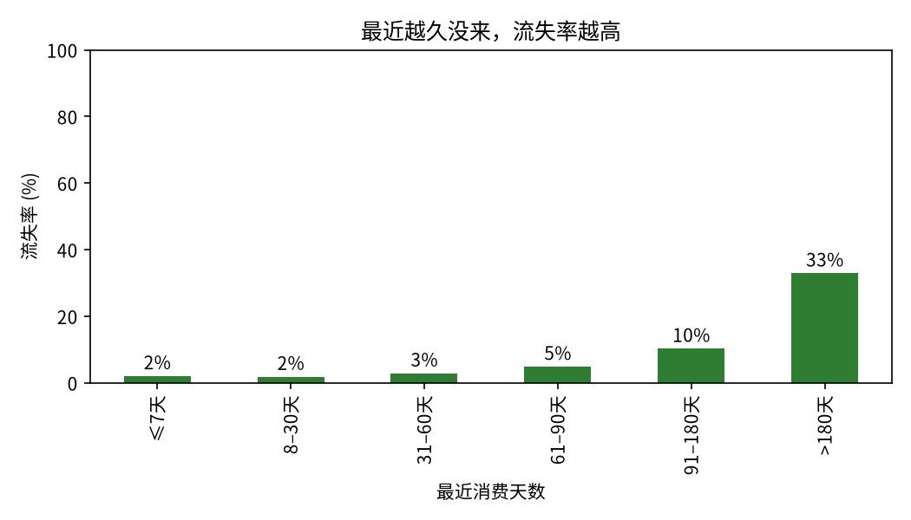
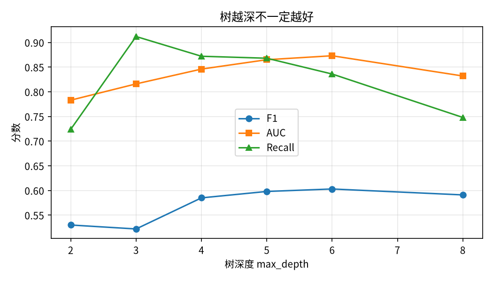
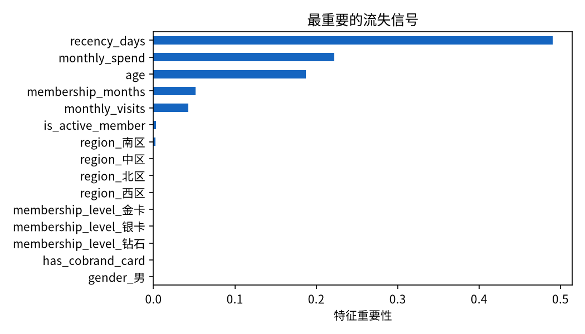

# 超市会员流失分析 | Customer Churn Prediction & Retention Analysis

> **数据说明：本项目使用真实会员数据**（`data/supermarket_members.csv`，n=5000，用户提供，已脱敏：会员编号为 10001–15000 的匿名编号，姓名列已删除，不含电话、卡号等个人信息）。早期演示版用的是合成数据（`data/supermarket_members_synthetic.csv`，固定种子 42，n=2000），已保留在 data/ 下作对照，不再用于本分析。

## 问题

超市会员不断流失，但运营不知道**哪些会员最可能流失、为什么流失、该先挽留谁**。本项目回答：

1. 会员整体流失率是多少？流失会员和留存会员在行为上有什么不同？
2. 能否用可解释的模型（决策树）提前识别高流失风险会员？
3. 不同树深度下模型表现如何？哪条流失路径最值得干预？
4. 针对高风险会员，超市可以采取哪些挽留动作？

## 数据

- 样本：5000 名会员；目标变量 `is_churn`（1=流失），无缺失值
- 特征：年龄、性别、居住区域、会员等级、会员时长（月）、月均消费、月均到店次数、最近消费天数、是否持有联名卡、是否活跃会员
- 未入模：`estimated_annual_spend`（预估年消费额）与月均消费几乎不相关（r≈0.00），流失组与留存组均值几乎相同（25203 元 vs 25466 元），无预测信号，故排除
- 字段说明见 `data/README.md`

## 方法

1. 描述分析：对比流失组与留存组的均值，按最近消费天数、会员等级、居住区域分组看流失率
2. 决策树分类：训练集 / 测试集 75:25 分层划分，`class_weight="balanced"`，比较 `max_depth` = 2、3、4、5、6、8
3. 模型选择：按测试集 F1 选最优深度；用特征重要性和决策规则解释模型

## 结果

- **整体流失率 20.0%**（1000 / 5000）
- **流失会员画像**：年龄平均 38.0 岁（留存组 48.8 岁）、月均消费 263 元（留存组 541 元）、月均到店 2.6 次（留存组 3.1 次）、最近消费天数平均 265 天（留存组 163 天）、会员时长 26.3 个月（留存组 31.5 个月）
- **按最近消费天数分组的流失率**：≤7 天 2.0% → 8–30 天 1.8% → 31–60 天 2.9% → 61–90 天 4.8% → 91–180 天 10.2% → >180 天 32.9%

  

- **按会员等级分组的流失率**：普通 27.2%（2034 人）→ 银卡 17.7%（1523 人）→ 金卡 13.0%（953 人）→ 钻石 11.0%（490 人）
- **按居住区域分组的流失率**：东区 17.9%、西区 19.5%、南区 20.3%、北区 20.9%、中区 21.3%，区域差异很小

- **模型比较**（测试集，n=1250）：

  | 树深度 | 准确率 | 精确率 | 召回率 | F1 | AUC |
  | --- | --- | --- | --- | --- | --- |
  | 2 | 0.743 | 0.418 | 0.724 | 0.530 | 0.783 |
  | 3 | 0.666 | 0.366 | 0.912 | 0.522 | 0.816 |
  | 4 | 0.753 | 0.440 | 0.872 | 0.585 | 0.846 |
  | 5 | 0.766 | 0.456 | 0.868 | 0.598 | 0.865 |
  | 6 | 0.780 | 0.472 | 0.836 | **0.603** | 0.873 |
  | 8 | 0.793 | 0.488 | 0.748 | 0.591 | 0.832 |

  

- **最优模型（深度 6）**：测试集准确率 0.780、精确率 0.472、召回率 0.836、F1 0.603、AUC 0.873；混淆矩阵 [[766, 234], [41, 209]]。树的第一条分裂是最近消费天数 ≤196.5 天。特征重要性：最近消费天数 0.490、月均消费 0.222、年龄 0.187、会员时长 0.052、月均到店次数 0.043，其余特征约 0——等级、区域、联名卡、活跃会员在树里几乎不起直接作用，等级差异主要由消费和沉默时长解释。

  

## 商业结论

- **干预窗口在 90–180 天**：91–180 天未到店的会员流失率 10.2%，>180 天升到 32.9%，等到 180 天再挽留基本来不及了。注意真实数据里 90 天内的流失率都很低（≤4.8%），不要照搬合成数据版的 30–60 天窗口。
- **先做第一版预警，不做精细画像**：深度 6 的树比合成数据版的最优深度 2 更深，真实流失模式更复杂；精确率 0.472，意味着预警名单里约一半人其实不会流失——挽留动作要选低成本的（券、提醒），不要一上来就给高成本补贴。
- **建议动作**（按优先级）：
  1. 对 90–180 天未到店的会员定向推送“回归券 + 新品试吃”，在流失前触达；
  2. 对普通等级、低消费的年轻会员做等级权益提醒和升级激励，重点是把月均消费做起来，而不是只发通用券；
  3. 对月均到店次数下降且沉默时间拉长的会员做客服回访，先解决体验问题再谈促销。
- **下一步**：补充 RFM 分层和挽留活动的 A/B 效果评估；核查 `estimated_annual_spend` 字段的口径。

## 如何运行

```bash
pip install -r requirements.txt
python data/generate_synthetic_data.py   # 可选：重新生成早期演示版数据（对照用）
cd notebooks && python build_notebook.py
python -m jupyter nbconvert --to notebook --execute --inplace customer_churn_analysis.ipynb
```

## 文件结构

```
customer-churn/
├── README.md
├── requirements.txt
├── data/
│   ├── README.md
│   ├── generate_synthetic_data.py       # 早期演示版数据生成脚本（对照用）
│   ├── supermarket_members_synthetic.csv  # 早期演示版合成数据（对照用）
│   └── supermarket_members.csv          # 真实会员数据（已脱敏），本分析用这份
├── notebooks/
│   ├── build_notebook.py            # 生成 notebook 的脚本（改内容先改这里，再重新生成并执行）
│   └── customer_churn_analysis.ipynb  # 已执行，含输出
└── outputs/
    ├── churn_rate_by_recency.png
    ├── depth_comparison.png
    └── feature_importance.png
```
